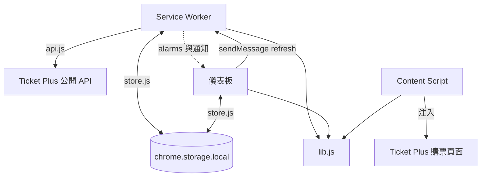
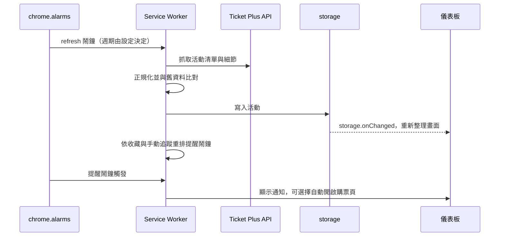
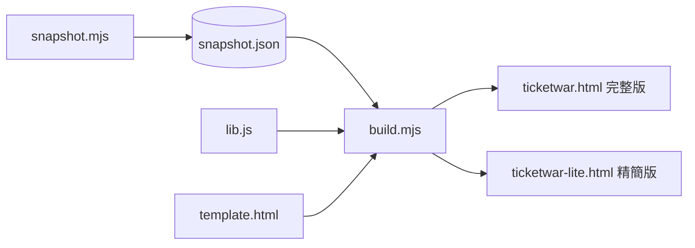
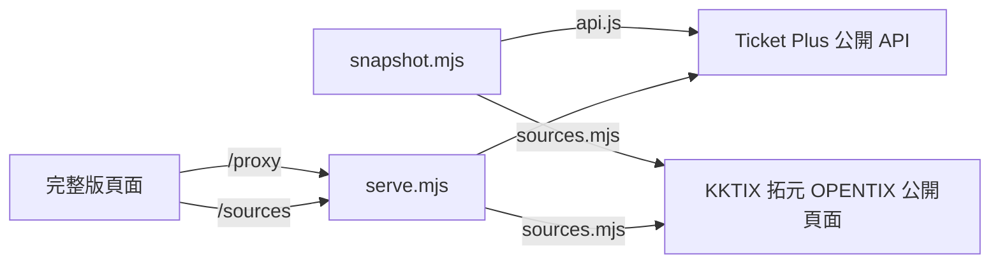

# 技術架構

專案包含兩個互相獨立的產品，共用同一份純函式程式庫 `extension/shared/lib.js`：

| 產品 | 位置 | 用途 |
| --- | --- | --- |
| Chrome 擴充功能 | `extension/` | 只服務 Ticket Plus：活動追蹤、提醒、購票頁輔助 |
| 網頁 Demo「TicketWar Pro」 | `demo/` | 單頁 HTML：整合四個平台的活動、個人票夾、購票演練 |
| 入口網站與客服 | `site/`、`scripts/`、`server/`、`api/` | GitHub Pages 靜態入口頁 + Gemini 客服後端，見第 9 節 |

共同原則：唯讀、被動。不登入、不儲存帳號密碼、不處理驗證碼與排隊、不自動送出付款。

## 總覽

```text
  extension/（Chrome 擴充功能）                demo/（網頁 Demo）
 ┌──────────────────────────────┐          ┌──────────────────────────────────┐
 │ Service Worker  儀表板  輔助面板│          │ snapshot.mjs ──► snapshot.json    │
 │   │ 抓取        │ 讀寫   │ 注入 │          │ sources.mjs（KKTIX/拓元/OPENTIX） │
 │   ▼             ▼        ▼      │          │ build.mjs ──► ticketwar.html      │
 │ api.js        store.js  購票頁   │          │            └► ticketwar-lite.html │
 └───────┬──────────────────────┘          │ serve.mjs（本機 127.0.0.1）        │
         │                                  └───────────────┬──────────────────┘
         │        extension/shared/lib.js（純函式，兩邊共用）  │
         └──────────────────────┬───────────────────────────┘
                                │
                                ▼
                       Ticket Plus 公開 API
              （Demo 另外讀 KKTIX、拓元、OPENTIX 公開頁面）
```

## 1. 目錄結構

```
extension/
  manifest.json            MV3 設定與權限
  background/service-worker.js
  dashboard/               儀表板（index.html、dashboard.js、dashboard.css）
  content/assist.js        Ticket Plus 頁面的輔助面板
  shared/
    lib.js                 純函式（不碰 DOM、chrome.*、網路）
    api.js                 Ticket Plus 公開資料抓取
    store.js               chrome.storage.local 封裝
demo/
  template.html            Demo 原始碼
  build.mjs                合併成單檔 HTML
  collect.mjs              彙整四個平台（snapshot 與 serve 共用）
  snapshot.mjs             抓取資料，寫入 data/snapshot.json
  sources.mjs              KKTIX、拓元、OPENTIX 轉接器
  serve.mjs                本機伺服器
  data/snapshot.json
  ticketwar.html          （產物）完整版
  ticketwar-lite.html     （產物）精簡版
scripts/                   make-icons.mjs、pack.mjs
tests/                     lib.test.mjs、sources.test.mjs 與 fixtures
server/                    客服機器人：chat-core.mjs（共用核心）、worker.js（Cloudflare）、site-guide.md、README.md；PLAN.md 為曾評估並擱置的後端方案
api/chat.js                Vercel 版客服函式
site/index.html            入口頁原始碼
scripts/                   另含 fetch-news.mjs、site-stats.mjs、build-site.mjs
.github/workflows/pages.yml  每日與推送時部署 GitHub Pages
```

整個專案沒有框架與打包工具，全部是原生 ES Module。唯一的建置步驟是 `demo/build.mjs` 的字串替換。

## 2. 擴充功能



### 職責

| 元件 | 職責 |
| --- | --- |
| Service Worker | 唯一會抓 Ticket Plus 資料的元件；比對新舊活動（`diffEvents`）、關鍵字通知、用 `chrome.alarms` 排定提醒與定期更新、收到 `refresh` 訊息時立即更新、通知點擊時開啟或聚焦分頁 |
| 儀表板 | 列表、篩選排序、收藏、手動追蹤、設定、匯出 `.ics`。只讀寫 storage，需要更新時傳訊息給 Service Worker；監聽 `storage.onChanged` 自動重新整理畫面 |
| Content Script | 開賣倒數（以伺服器 `Date` 標頭校正）、檢查清單、依偏好選場次／票區／張數／連續座位。以 `import(chrome.runtime.getURL('shared/lib.js'))` 動態載入程式庫 |

### 更新與提醒流程



設定或收藏變動時，Service Worker 會延遲 300 毫秒後重新排程，避免連續寫入造成重複排程。

### 權限

- `storage`、`alarms`、`notifications`
- `host_permissions` 與 content script 比對網址：`ticketplus.com.tw`、`www.ticketplus.com.tw`、`apis.ticketplus.com.tw`
- `shared/lib.js` 以 `web_accessible_resources` 開放給上述網址

### 購票輔助的界線

輔助只做選項套用與提示。遇到驗證碼、排隊、登入、付款頁一律暫停並提示，預設關閉。

## 3. 網頁 Demo

### 建置流程



- `template.html` 有兩個佔位符：`/*__LIB__*/`、`/*__SNAPSHOT__*/null`。
- `build.mjs` 會去掉 `lib.js` 的 `export` 再內嵌，所以 `lib.js` 不可使用 `import` 或 `export { … }`，建置時會檢查。
- 頁面內的 `slim()` 與 `build.mjs` 的 `slim()` 必須保持一致。
- 精簡版：移除 `<!--LITE:OFF-->…<!--/LITE:OFF-->` 之間的區塊（「重新抓取」按鈕與題庫編輯面板），活動只保留有開賣日期者另加 40 筆，每活動最多 12 個票區。完整版只移除標記本身。

### 資料取得



- 預設使用內建快照，不需要網路請求資料。
- 完整版透過本機伺服器「重新抓取」，因為這些網站不允許跨網域存取。
- 精簡版沒有重新抓取，也不依賴伺服器。

| 平台 | 來源 | 可用欄位 |
| --- | --- | --- |
| Ticket Plus | 官方公開 JSON | 開賣時間、票價、票區（最完整） |
| 拓元 | 公開活動列表 | 日期、場館（`dateOnly`） |
| KKTIX | 公開 Atom | 日期、場館，無開賣時間 |
| OPENTIX | 網站地圖與活動頁 | 日期、場館，無開賣時間 |

### 本機伺服器

只綁定 `127.0.0.1`，僅接受 `GET`：

- `/`：提供 `ticketwar.html`
- `/sources`：抓取三個平台，10 分鐘快取並合併同時請求
- `/proxy?path=`：轉送 Ticket Plus 公開 JSON，路徑須符合白名單

轉接器 `fetchText` 只允許 `https:` 與白名單主機（`tixcraft.com`、`kktix.com`、`www.opentix.life`），低頻、唯讀。遇到驗證關卡就不抓，欄位標示「未提供」。

### 頁面（`template.html`）

| 區塊 | 說明 |
| --- | --- |
| 看板 | 平台、分類、城市、狀態、日期篩選；卡片與列表檢視；智慧分組 |
| 票夾 | 「想搶」與「已購」集中顯示，匯出 `.ics` |
| 演練場 | 依平台流程模擬購票、計時評級、題庫與成績榜 |

啟動順序：`init → bind → 渲染 → setTab`，之後每秒 `tick` 更新倒數。

狀態存在 `localStorage`，鍵名帶版本號：`tw.events.v2`、`tw.mine.v1`、`tw.fav.v1`、`tw.quiz.v1`、`tw.scores.v1`、`tw.ui.v1`。讀取時驗證形狀，不合就回退預設值。

頁面執行時從 CDN 載入 Tailwind 與 Font Awesome，需要連網。

## 4. 共用程式庫 `lib.js`

| 類別 | 函式 |
| --- | --- |
| 時間 | `parseDateRange`、`parseTimeRange`、`toEpoch`、`toMs`、`formatCountdown`、`formatDateTime`、`clockSample`、`median` |
| 正規化 | `normalizeSession`、`normalizeProduct`、`normalizeArea`、`normalizeEvent`、`classify`、`cityOf` |
| 狀態與比對 | `saleStatus`、`nextSaleStart`、`diffEvents`、`matchesKeywords` |
| 提醒與匯出 | `planAlarms`、`parseAlarmName`、`buildIcs` |
| 購票輔助 | `pickSession`、`pickArea`、`findConsecutive`、`isSoldOutText`、`dateFromText`、`routeOf`、`eventIdFromUrl` |
| 其他 | `mapLimit`、`TZ`（固定 `+08:00`）、`CATEGORIES`、`STATUS_LABEL` |

## 5. 安全做法

- 遠端文字以 `textContent` 或安全的建構函式寫入 DOM，不用 `innerHTML` 拼接。
- 網址只接受 `https:`。
- 抓取只對白名單網域與路徑；伺服器只綁本機。
- 不儲存任何帳號、密碼或付款資訊。

## 6. 測試

- `npm test`：`tests/lib.test.mjs` 測純函式，`tests/sources.test.mjs` 測各平台解析；fixtures 取自真實 API 回應的裁切。
- Demo 的端對端行為（票夾、分組、列表檢視、四個平台演練、精簡版）以 jsdom 驗證過，但腳本還在專案外，尚未納入 repo。
- 未驗證：購票輔助的票區、張數、選位選擇器為推測；Demo 畫面尚未在真實 Chrome 逐頁檢視。

## 7. 指令

```
npm test              # 單元測試
npm run icons         # 產生圖示
npm run pack          # 打包擴充功能 zip（dist/）
npm run demo:update   # 抓取全部平台 → 快照 → 重建 HTML（一條指令）
npm run demo:snapshot # 只抓取
npm run demo:build    # 只重建完整版與精簡版 HTML
npm run demo          # 本機伺服器（127.0.0.1:8787）；頁面「重新抓取」更新全部平台，「更新並存檔」(POST /update，限本機頁面) 另寫入快照並重建 HTML
```

## 8. 取捨與限制

- 沒有後端：個人使用不需要，也避免保管憑證。評估紀錄見 [server/PLAN.md](server/PLAN.md)。
- 公開資料不含庫存與表演者；分類由標題推測；「熱門」為啟發式。
- 各平台網站改版會讓轉接器或輔助選擇器失效，需人工維護。
- 時鐘校正精度約 ±1 秒。

## 9. 入口網站與客服機器人

```text
 GitHub Actions（每日 06:00 / 推送 main / 手動）
   測試 → demo/snapshot.mjs → scripts/fetch-news.mjs → npm run site:build → 部署 Pages
                                                          │
                          dist-site/  index.html（入口）  app/index.html（平台）  chat-context.json
                                                          │
 瀏覽器（聊天視窗）── POST /api/chat ──► Vercel 函式（或 Worker）── generateContent ──► Gemini
                                              │ 讀 chat-context.json（快取 10 分鐘）
```

- **建置**：`scripts/build-site.mjs` 把 `site/index.html` 的佔位符換成資料（`/*__DATA__*/`、`/*__STATS__*/`）與 `CHAT_API_URL`（`/*__CHAT_URL__*/`，必須是 https），同時輸出 `app/index.html` 與 `chat-context.json`。統計函式在 `scripts/site-stats.mjs`（純函式，有測試），也被內嵌進入口頁供前端互動篩選使用。
- **新聞**：`scripts/fetch-news.mjs` 抓 Google News RSS，先排除港澳、中國與海外來源，再要求來源名稱或網域在台灣媒體白名單內，依主題分類後寫入 `demo/data/news.json`。
- **平台頁差異**：`demo/build.mjs` 以 `<!--LITE:OFF-->`、`<!--WEB:ON-->` 標記產生三種版本；「返回入口」按鈕只存在於網頁版。
- **客服**：`server/chat-core.mjs` 是不含金鑰與網路的純函式（組提示詞、驗證輸入、拆追問、限流、CORS）；`api/chat.js` 與 `server/worker.js` 只負責收發與呼叫 Gemini。前端只把 https 連結轉成 `<a>`，其餘一律當純文字。
- **安全**：金鑰只在後端環境變數；CORS 白名單；單則 300 字、最近 6 則、每 IP 每分鐘 8 次；活動資料與使用者訊息都視為資料，不當指令。
- **資料新鮮度**：自動更新只重新部署網站，不提交回 repo；細節與指令見 [README.md](README.md)，客服設定見 [server/README.md](server/README.md)。
